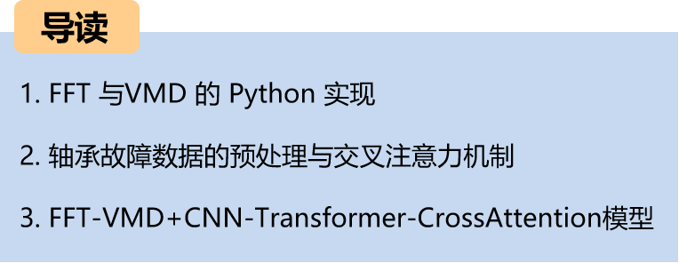
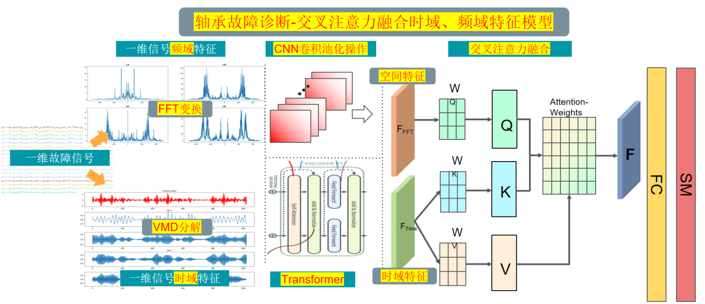
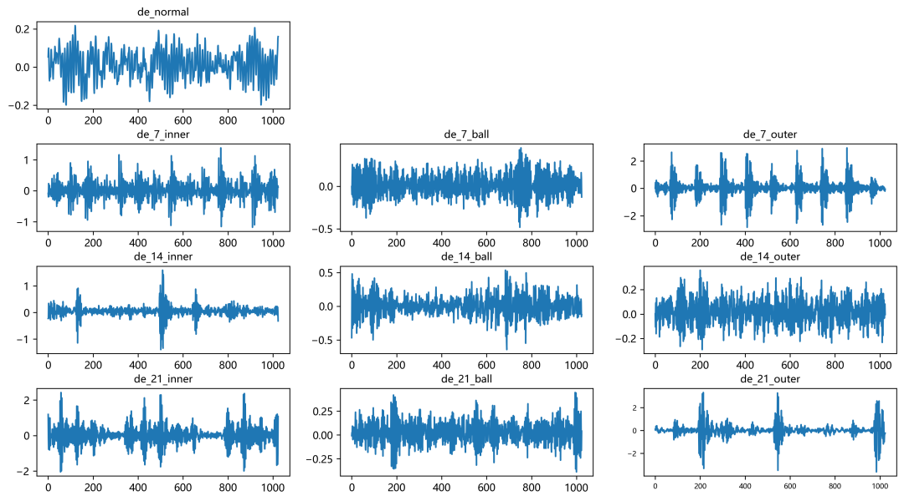
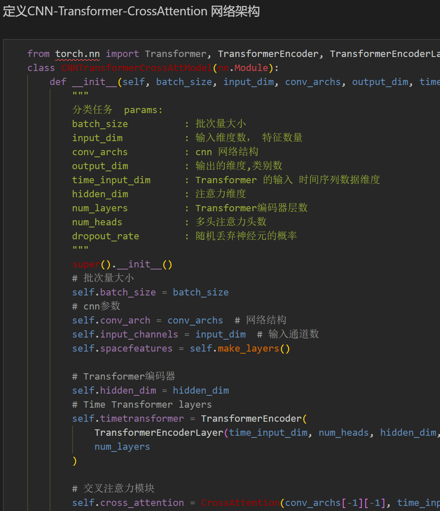
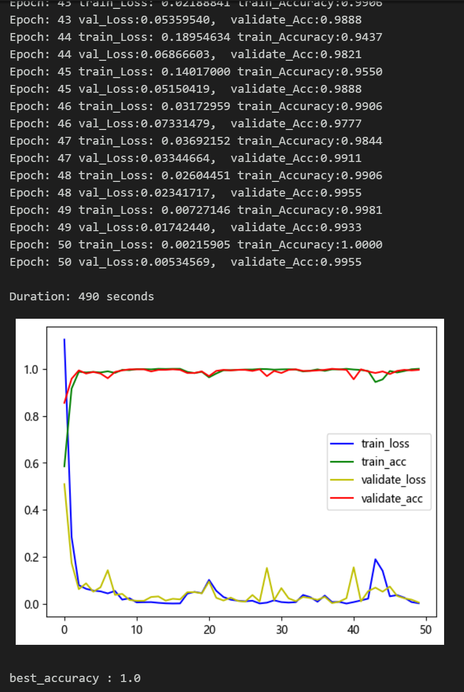
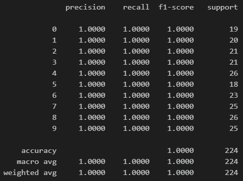
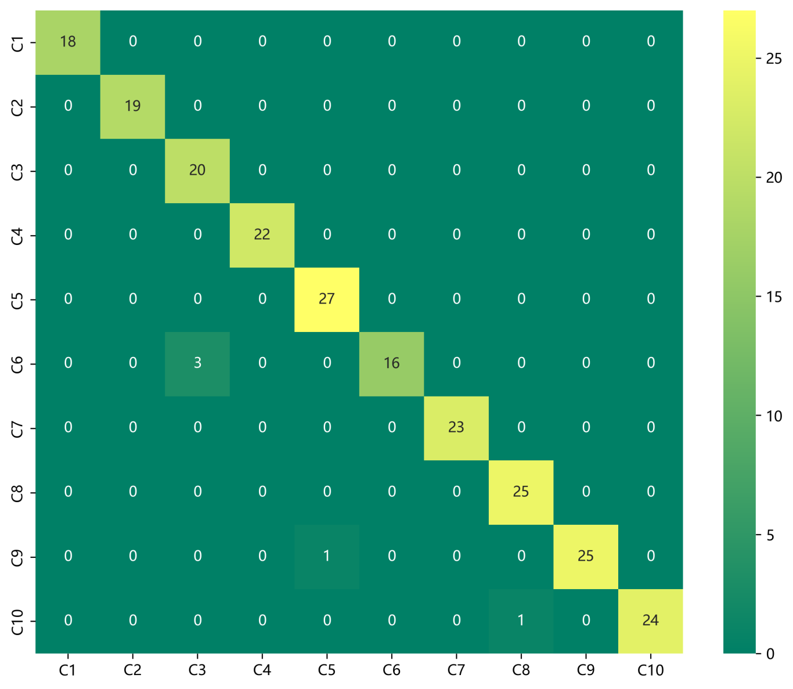
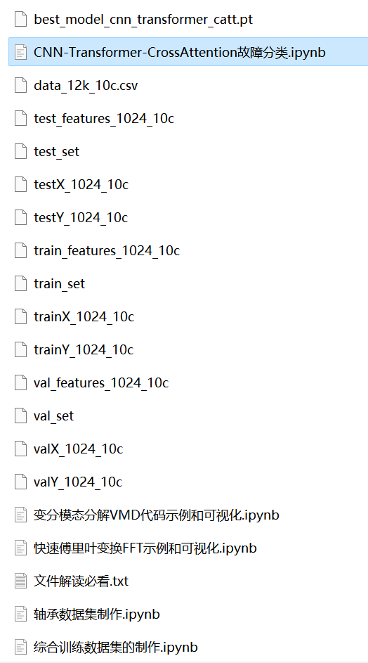

# Python Bearing Fault Diagnosis (16) High-Innovation Fault Identification Model (II)

Recommendation - Family Pack, with higher cost-performance ratio! Innovation points:
1. Preprocessing part: Combines Fast Fourier Transform (FFT) and Variational Mode Decomposition (VMD) for signal time-frequency and domain feature extraction, capable of mining multi-scale features in fault signals;
2. Then, utilizes Convolutional Neural Network (CNN) to extract spatial features of the multi-scale features after preprocessing fault signals, and employs Transformer to extract temporal features of the multi-scale features after preprocessing fault signals;
3. Finally, uses cross attention for fusion of spatiotemporal features, thereby enhancing the representation capability of features to achieve fault signal recognition, including a complete bearing fault dataset, as well as generated fault signal datasets, classification data, and label sets, all of which can be run, along with examples of FFT-VMD decomposition.
50 epochs, accuracy 100%, with FFT-VMD+CNN-Transformer-CrossAttention network achieving significant classification results, the model is able to fully extract spatial and temporal features as well as frequency domain features from bearing fault signals, converges quickly, and performs exceptionally well, currently the highest precision method among previous articles. High innovation level also!!!
Including code for data preprocessing and FFT, VMD, CNN-Transformer-CrossAttention classification.
Environment: Python 3.9
Preface:
This article is based on CWRU bearing data for fast Fourier transform (FFT) and variational mode decomposition (VMD) data preprocessing, and finally implements a spatial-temporal feature fusion model for fault data classification through Python using cross attention \tCNN-Transformer-CrossAttention. A detailed introduction to CWRU bearing data can be found in the following article:
Python-CWRU Bearing Data Interpretation and Classification Processing
1.1 The overall structure of the model is as follows:
   - A one-dimensional fault signal is processed through FFT transformation and VMD decomposition, then the results are stacked. Through CNN and Transformer networks, spatial and temporal features are extracted. Finally, the features from both time and frequency domains are fused using an attention mechanism to enhance model performance and generalization capabilities.
   - 1.2 In-depth innovation points:
   - When processing fault signals, extracting time-frequency domain features is crucial. Combining FFT and VMD can effectively mine multi-scale features in the signal.
 (1)Preprocessing - FFT:
     FFT is a widely used method for frequency domain analysis, which converts signals from the time domain to the frequency domain to obtain the spectral information of the signal. By FFT, we can obtain the energy distribution of the signal at different frequencies, thereby understanding the frequency components of the signal. However, FFT only provides the spectral information of the signal at a certain moment, unable to reflect the change of the signal over time.
 (2)Preprocessing - VMD:
     To address this issue, variational mode decomposition (VMD) can be introduced. VMD is a mode decomposition method based on adaptive adjustment of the signal, which can decompose the signal into a series of mode functions, each representing the characteristic of the signal at different scales. By VMD, we can obtain the time-domain feature information of the signal at different scales.
 (3)Preprocessing - feature fusion:
Combining FFT and VMD, one can first utilize FFT to transform the signal into the frequency domain, obtaining the spectrum information of the signal. Subsequently, simultaneously applying VMD to the fault signal will decompose it into a series of mode functions. These mode functions represent the time-domain characteristics at different scales. By analyzing this information, we can mine multi-scale features from the fault signal, thereby better understanding its time-frequency characteristics. This method enables a more comprehensive analysis of signals, aiding in signal processing tasks such as fault detection and diagnosis. After extracting multi-scale features through FFT and VMD, they are fused and used as inputs for an innovative network model, which is then trained.
(4) Innovative Network Model - CNN Spatial Feature Extraction:
\tInput: Feature of FFT and VMD fusion
Operation: Convolution and pooling operations are performed on each input feature to extract spatial features.
\tOutput: Convolutional pooling after feature representation, used to capture vibration spatial features at different frequencies.
\t  
(5) Innovative Network Model - Transformer Time-series Feature Extraction:
\tInput: Feature of FFT and VMD fusion
Operation: Transformer network learns sequence information, focusing on important temporal features.
\tOutput: The time-series feature representation processed by Transformer has better fault signal time-series modeling capability.
(5) Multi-Scale Feature Fusion - Cross Attention Mechanism for Feature Fusion:
\tInput: CNN extracted spatial features, Transformer extracted temporal features
Cross Attention Mechanism: Utilizes the cross attention mechanism to fuse features from both time and frequency domains. By calculating attention weights, the model can focus more on important features, enhancing its performance and generalization capabilities.
2. Data Preprocessing for Bearing Faults
2.1 Import data
1. Preprocessing for Classification of Faults 10
2.1 The bearing data from Case Western Reserve University is used for the classification of faults 10:
   - train_set, val_set, test_set are divided into 70% training set, 20% validation set, and 10% testing set respectively. Finally, the data is saved.
2.2 Visualization of Fault FFT Transformation
2.3 Visualization of Fault VMD Decomposition
2.4 Preparation of a dataset for feature preprocessing of fault data
3 Cross Attention Mechanism
3.1 Concept of Cross Attention
   - In the Transformer architecture, an attention mechanism that mixes two different embedding sequences is introduced.
   - Both sequences must have the same dimensionality.
   - Both sequences can be in different patterns (e.g., text, sound, image).
   - One sequence serves as input Q, defining the output sequence length, while the other provides input K&V.
3.2 Cross-attention algorithm
   - Two sequences S1 and S2 are involved.
   - Calculate K and V for S1.
   - Calculate Q for S2.
   - Compute the attention matrix based on K and Q.
   - Apply V to the attention matrix.
   - The output sequence length matches S2.
   - During the fusion process, spatial features obtained through CNN convolutional pooling operations are used as query sequences, while the time-series features output by BiLSTM are treated as key-value pairs sequences. By calculating the attention weights between the query sequence and the key-value pairs sequence, we can model the degree of association between different features.
4 Blind Fault Diagnosis Classification Based on FFT-VMD+CNN-Transformer-CrossAttention
4.1 Define the classification network model based on FFT-VMD+CNN-Transformer-CrossAttention
4.2 Set parameters and train the model
50 epochs, with 100% accuracy using the FFT-VMD+CNNTransformer-CrossAttention network. The Fast Fourier Transform (FFT) and Variational Mode Decomposition (VMD) can effectively extract multi-scale features from signals. The innovative model is capable of fully extracting spatial and temporal features of bearing fault signals, achieving fast convergence, superior performance, high accuracy, and cross attention mechanisms can model the correlation degree between different features, extracting important features from fault signal frequency domain and time domain characteristics, resulting in significant improvements.
Note: Adjust parameters accordingly:
- Increase the number of CNN layers and hidden layer dimensions, adjust learning rate;
- Adjust the number of Transformer encoder layers and attention dimensionality/multi-head attention heads, increase more epochs (be cautious to prevent overfitting);
- Change the shape of one-dimensional signal stacking (set appropriate length and dimension);
- Model evaluation:
- Accuracy, Precision, Recall, F1 Score
- Fault classification confusion matrix:

## Images

<!-- PAYMENT_BLOCK -->

## Get this dataset

- Payment link (Stripe): [Buy now](https://buy.stripe.com/3cs8yP7sY87d0vu9AB)
- Payment QR code: 

<!-- /PAYMENT_BLOCK -->
